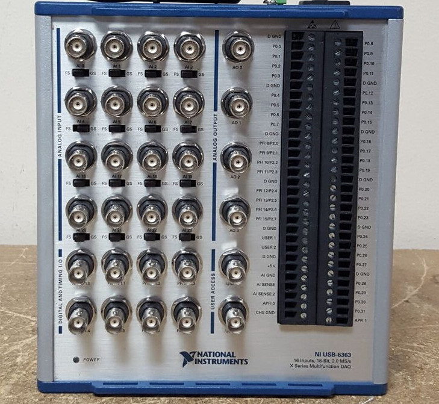

# A remotely-controlled laser controller using a PC running NI LabVIEW

> A LabVIEW library (.lvlib) for remotely operating the LDC-3736 Precision Laser Controller. Because who wants to manually adjust laser settings when you can automate it?

## What does this do?

This project gives you LabVIEW VIs to control your LDC-3736 laser controller from your computer. No more walking over to the laser bench every time you need to tweak something! You can change settings, monitor outputs, and even integrate it with data acquisition systems.

## Getting started

1. Open the _laser_controller.lvproj_ LabVIEW project
2. Expand _laser_controller.lvlib_ - all the VIs live in the repo root and are members of the library
3. Pick any `*.vi` file and run it to see what it does
4. Start with the basic ones (`laser_constant_current_output.vi`, `laser_single_current_output.vi`), then work your way up to the DAQ integration ones (`laser_constant_current_output_with_DAQ_analog_output_*.vi`, `current_pulse_train*.vi`)

## Power calibration

`laser_calibrate.vi` steps the laser through the current levels listed in `calibration_config.csv` (`Current_mA, time_s` - the drive current and how long to hold it), and measures the optical output at each step with an Ophir NOVA power meter (`power_measure.vi`). `convert_current_to_power.vi` then maps a drive current to optical power.

The Ophir NOVA support (`Ophir_NOVA/`) is built on Ophir's LabVIEW COM demo, which is included as-is (`LabVIEW COM Demo.llb` + its `.doc`) because the library depends on it.

## What you'll need

**Software:**

- LabVIEW 2025 Q3 or later - grab it from the [NI website](https://www.ni.com/en/support/downloads/software-products/download.labview.html)
- LDC-3736 LabVIEW drivers from [Newport's site](https://www.newport.com/medias/sys_master/images/images/h46/he4/8797190881310/LDC-37X6-LabVIEW-Drivers-Version-1.1.zip)
- If you want to try the DAQ examples: NI-DAQmx drivers
- For power measurement/calibration: Ophir StarLab / OphirLMMeasurement COM object (installed with Ophir's StarLab software)

**Hardware:**

- Your LDC-3736 laser controller (obviously!)
- USB-A to USB-B cable (the USB port is hiding on the back panel)
- For DAQ examples: Any NI-DAQ device with at least 1 analog output
- For power measurement/calibration: Ophir NOVA power meter with a compatible sensor

## A few helpful notes

**About LabVIEW on different platforms:** Look, I'm a hardcore Linux user, but I'll be honest - run this on Windows if you can. LabVIEW's Linux support feels like an afterthought, and the NI Package Manager on Windows makes installing drivers so much easier. I haven't tried macOS, but I suspect it's somewhere in between.

**About those drivers:** Most instrument manufacturers (the good ones anyway) provide LabVIEW drivers so you can control oscilloscopes, multimeters, function generators, and yes, laser controllers, right from your computer. Newport did a decent job with theirs.

**DAQ setup:** I used a USB-6363 for testing - it's got 4 analog outputs which is overkill for most laser applications, but hey, it works great. Any DAQ with at least 1 analog output should work fine for the examples.

## Troubleshooting

If something's not working:

1. Make sure your laser controller shows up in NI MAX (Measurement & Automation Explorer)
2. Check that you installed the Newport drivers properly
3. Try the simplest example (laser_constant_current_output.vi) first - if that doesn't work, it's probably a driver/connection issue
4. The USB connection can be finicky - sometimes unplugging and reconnecting helps

## Contributing

Found a bug? Want to add a feature? Feel free to email me, open an issue or send a pull request. I'm pretty responsive, especially if you include details about what you're trying to do.
