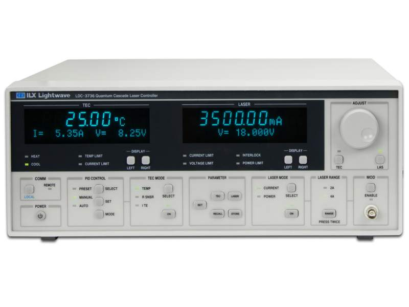

# A remotely-controlled laser controller using a PC running NI LabVIEW

> A LabVIEW libary (.lvlib) for remotely operating the LDC-3736 Precision Laser
> Controller.

## Usage

1. Open the laser_controller.lvproj LabVIEW project
2. Navigate to the Examples directory
3. Choose a \*.vi to run

## Requirements

- A PC with 2025 Q3 LabVIEW software installed. Check out the installation guide
  on National Instruments [website](https://www.ni.com/en/support/downloads/software-products/download.labview.html) [1]

- LDC-3736 (obviously)

- A USB-A to USB-B cable. USB-port is on the rear panel of the laser controller

- Proper LabVIEW drivers for the LDC-3736. Install the drivers from Newport's
  [website](https://www.newport.com/medias/sys_master/images/images/h46/he4/8797190881310/LDC-37X6-LabVIEW-Drivers-Version-1.1.zip) [2]

- (For DAQ examples) A NI-DAQ data acquisition device and the appropriate DAQmx
  LabVIEW drivers [3]

## Notes

[1] Although a hardcore Linux user, I strongly recommend running LabVIEW on
Windows. Linux support for LabVIEW feels almost like an afterthought. On Windows,
you can easily manage your NI softwares, drivers, etc... using the NI Package
Manager application. I have not attempted to run LabVIEW on macOS.

[2] Normally, OEMs package a LabVIEW driver so that users can operate their
instruments (e.g oscilloscopes, multimeters, function generators, etc...) via
a VI's front panel (remotely!)

[3] I used a , which has 4 analog outputs!
Any DAQ with at least 1 analog output should work for the \*.vi DAQ examples
